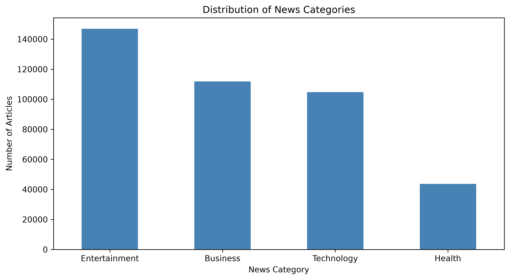
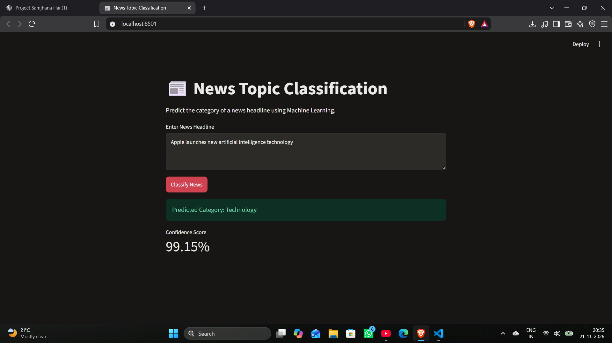

# 📰 News Topic Classification Using NLP

### 🚀 Intelligent News Headline Classification with Machine Learning


---

## 🌟 Project Overview

In today's digital world, thousands of news articles are published every minute. Manually organizing these articles into categories can be time-consuming.

**News Topic Classification** is a Natural Language Processing (NLP) project that automatically identifies the topic of a news headline using Machine Learning.

The system analyzes a headline and predicts its most relevant category, along with a confidence score, through an interactive Streamlit web application.

**Project Goal:** Build an accurate, efficient, and user-friendly news classification system.

---

## ✨ Key Features

- 🧠 **Machine Learning Powered** — Uses Logistic Regression for multiclass classification.
- 📰 **Headline Classification** — Predicts news topics from user-provided headlines.
- 📊 **High Accuracy** — Achieves 93.82% accuracy on the test dataset.
- 🎯 **Confidence Score** — Displays the model's estimated prediction probability.
- 🧹 **Text Preprocessing** — Cleans and normalizes news headlines.
- ⚡ **TF-IDF Feature Extraction** — Converts text into numerical features.
- 🌐 **Interactive Web Application** — Built using Streamlit.
- 📈 **Model Evaluation** — Includes precision, recall, F1-score, and confusion matrix.
- 📉 **Exploratory Data Analysis** — Visualizes the distribution of news categories.

---

## 🗂️ News Categories

The model classifies news headlines into four categories:

| Category | Label | Description |
|---|---|---|
| 💼 Business | `b` | Finance, companies, markets, and economic developments |
| 🎬 Entertainment | `e` | Movies, celebrities, music, and entertainment news |
| 🏥 Health | `m` | Medical research, healthcare, and health-related developments |
| 💻 Technology | `t` | Software, AI, gadgets, and technological innovations |

---

## 📚 Dataset Information

**Dataset:** UCI News Aggregator Dataset

**Source:** [UCI Machine Learning Repository](https://archive.ics.uci.edu/dataset/359/news+aggregator)

The original dataset contains **422,419 news articles**.

### 📊 Original Dataset Distribution

| Category | Number of Articles |
|---|---:|
| 🎬 Entertainment | 152,469 |
| 💼 Business | 115,967 |
| 💻 Technology | 108,344 |
| 🏥 Health | 45,639 |
| **Total** | **422,419** |

The dataset includes news headlines, URLs, publishers, categories, timestamps, and other metadata.

For model training, this project primarily uses the news headline and its corresponding category.

**Note:** The distribution above represents the original dataset before preprocessing and duplicate removal. The number of records used for training and testing is lower after cleaning.

### 📥 Dataset Download

The dataset is not included in this GitHub repository because of its size.

To reproduce the project:

1. Download the News Aggregator Dataset from the UCI Machine Learning Repository.
2. Extract the dataset.
3. Create a folder named `data` in the project root if it does not exist.
4. Place the dataset inside that folder.
5. Rename the dataset file to `newsCorpora.csv` if necessary.

Expected location:

`data/newsCorpora.csv`

---

## ⚙️ Project Workflow

The complete machine learning pipeline follows these steps:

1. **Dataset Collection** — Download the labelled news dataset.
2. **Exploratory Data Analysis** — Examine dataset structure and category distribution.
3. **Data Cleaning & Preprocessing** — Normalize headlines and remove duplicate records.
4. **Train-Test Split** — Divide the dataset into training and testing sets (80:20).
5. **TF-IDF Feature Extraction** — Convert headlines into numerical feature vectors.
6. **Model Training** — Train a multiclass Logistic Regression classifier.
7. **Model Evaluation** — Calculate accuracy, precision, recall, F1-score, and confusion matrix.
8. **Model Serialization** — Save the trained model and TF-IDF vectorizer.
9. **Web Application** — Build an interactive prediction interface using Streamlit.

### 🧹 Text Preprocessing

The preprocessing pipeline includes:

- Converting text to lowercase
- Removing unnecessary special characters and numbers
- Removing extra whitespace
- Removing English stop words during TF-IDF vectorization
- Removing duplicate headline-category records

### 🤖 Machine Learning Algorithm

**Logistic Regression** is used for multiclass news classification.

TF-IDF (Term Frequency–Inverse Document Frequency) converts news headlines into numerical feature vectors, which are then used to train the classification model.

---

## 📊 Exploratory Data Analysis

Exploratory Data Analysis (EDA) helps us understand the distribution and characteristics of the news dataset before model training.

### 📈 News Category Distribution

The following visualization shows the number of articles belonging to each category after preprocessing.



The visualization helps identify differences in the number of available training examples across categories.

---

## 📈 Model Performance

The trained model achieved the following performance on **81,462 test articles**.

### 🏆 Overall Accuracy: 93.82%

| Category | Precision | Recall | F1-Score |
|---|---:|---:|---:|
| 💼 Business | 0.92 | 0.92 | 0.92 |
| 🎬 Entertainment | 0.96 | 0.98 | 0.97 |
| 🏥 Health | 0.95 | 0.91 | 0.93 |
| 💻 Technology | 0.92 | 0.92 | 0.92 |
| **Macro Average** | **0.94** | **0.93** | **0.93** |
| **Weighted Average** | **0.94** | **0.94** | **0.94** |

### 📉 Confusion Matrix

The confusion matrix visualizes correct and incorrect predictions across the four news categories.


The model performs particularly well on Entertainment headlines, while some confusion exists between Business and Technology.

### 🔍 Performance Analysis

- The model achieves an overall accuracy of approximately 93.82%.
- Entertainment has the highest reported F1-score.
- Health headlines have a slightly lower recall compared with some other categories.
- TF-IDF and Logistic Regression provide a strong baseline for multiclass news headline classification.

---

## 🖥️ Web Application

The project includes a Streamlit-based interface where users can enter a news headline and instantly receive a predicted category and confidence score.

### 📸 Application Screenshot



### 🔎 Example Prediction

**Input Headline:**

> Apple launches new artificial intelligence technology

**Model Output:**

- 🏷️ **Predicted Category:** Technology
- 🎯 **Confidence Score:** 99.15%

**Note:** The confidence score represents the model's estimated probability, not a guarantee of correctness.

### ✨ Application Features

- Classifies headlines into Business, Entertainment, Health, and Technology.
- Uses TF-IDF Vectorization and Logistic Regression.
- Provides instant category predictions.
- Displays prediction confidence scores.
- Provides an interactive interface using Streamlit.

---

## 🛠️ Tech Stack

| Technology | Purpose |
|---|---|
| Python | Programming language |
| Pandas | Dataset manipulation |
| NumPy | Numerical operations |
| Scikit-learn | Machine learning and evaluation |
| TF-IDF | Text feature extraction |
| Matplotlib | Data visualization |
| Streamlit | Interactive web interface |
| Jupyter Notebook | Experimentation and analysis |
| Pickle | Model serialization |

---

## 📁 Project Structure

```text
news-topic-classification/
│
├── data/
│   └── newsCorpora.csv          # Download separately
│
├── notebooks/
│   └── news_classification.ipynb
│
├── models/
│   ├── news_model.pkl
│   └── tfidf_vectorizer.pkl
│
├── screenshots/
│   ├── app_prediction.png
│   ├── category_distribution.png
│   └── confusion_matrix.png
│
├── app.py
├── requirements.txt
├── .gitignore
└── README.md
```

**Note:** The `data/newsCorpora.csv` file is stored locally and excluded from Git tracking.

---

## 🚀 Installation & Setup

### 1️⃣ Clone the Repository

```bash
git clone https://github.com/DevanshKumar01/news-topic-classification.git
cd news-topic-classification
```

### 2️⃣ Create a Virtual Environment

```bash
python -m venv .venv
```

### 3️⃣ Activate the Environment

**Windows (PowerShell):**

```powershell
.\.venv\Scripts\Activate.ps1
```

**macOS / Linux:**

```bash
source .venv/bin/activate
```

### 4️⃣ Install Dependencies

```bash
python -m pip install -r requirements.txt
```

### 5️⃣ Download the Dataset

Download the dataset from:

https://archive.ics.uci.edu/dataset/359/news+aggregator

Place the extracted dataset at:

```text
data/newsCorpora.csv
```

The dataset is required for running the training notebook. The Streamlit application uses the previously trained model files.

### 6️⃣ Run the Streamlit Application

```bash
python -m streamlit run app.py
```

### 7️⃣ Open the Application

Visit:

**http://localhost:8501**

Enter a news headline and click **Classify News** to view the prediction.

### 8️⃣ Run the Jupyter Notebook (Optional)

Open:

```text
notebooks/news_classification.ipynb
```

Select the project's Python environment as the notebook kernel.

Run the notebook cells in sequence to reproduce preprocessing, training, evaluation, and visualizations.

---

## 🎯 Learning Outcomes

This project demonstrates practical experience with:

- Natural Language Processing fundamentals
- Text preprocessing and cleaning
- Exploratory Data Analysis
- Feature extraction using TF-IDF
- Supervised machine learning
- Multiclass text classification
- Model training and testing
- Performance evaluation
- Model serialization and inference
- Interactive ML application development

---

## 🔮 Future Improvements

Potential enhancements include:

- 🤖 Transformer-based classification using BERT
- 🌍 Multilingual news classification
- 📄 Full-article classification
- 📊 Interactive category probability charts
- 🔗 Classification using news article URLs
- ☁️ Cloud deployment
- 📱 Improved mobile-responsive interface

---

## 👨‍💻 Project Team

**NLP Capstone Project — P3**

**Group 13 | K.R. Mangalam University**

| Team Member | Role |
|---|---|
| Harsh Kaushik | Team Member |
| Randeep Kaur | Team Member |
| Devansh Kumar | Team Member |

**Academic Program:** B.Tech Computer Science & Engineering (AI & ML)

---

## 📌 Project Status

- ✅ Dataset Collection
- ✅ Data Cleaning & Preprocessing
- ✅ Exploratory Data Analysis
- ✅ TF-IDF Feature Engineering
- ✅ Model Training
- ✅ Model Evaluation
- ✅ Confusion Matrix
- ✅ Streamlit Web Application
- ✅ Prediction Testing
- ✅ GitHub Repository Created
- ✅ README Documentation
- 🚧 Final Project Report
- 🚧 Final Presentation

---

## 📋 Academic Project Information

**Project:** P3 — News Topic Classification

**Course:** Natural Language Processing (NLP) Capstone Project

**University:** K.R. Mangalam University

**Group:** 13

**Student:** Devansh Kumar

**Roll Number:** 2401730127

---

⭐ If you found this project useful, consider starring the repository!
